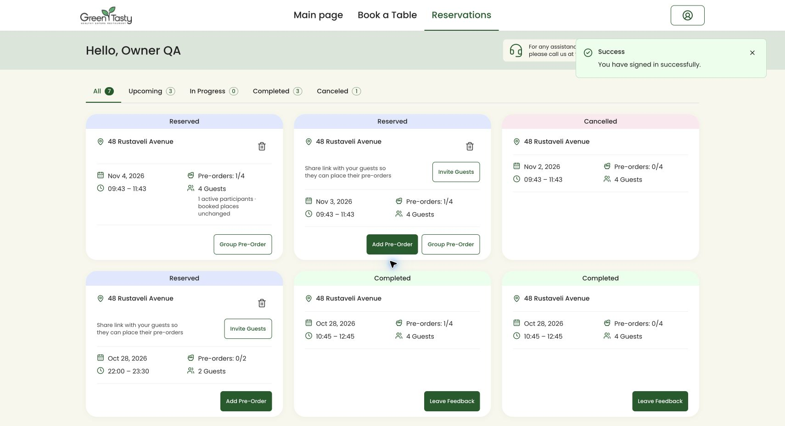

# Вход посетителя в Reservations — 28 октября 2026

Причина возврата на старый экран `Your reservation`: в сессии сохранялся `url.intended` со ссылкой `/reservations/{id}`. Ответ входа теперь заменяет старые адреса деталей и подтверждения брони на `/reservations`, включая адрес с якорем группового предзаказа. Сохранённый адрес потребляется один раз. Регистрация использует то же правило. Вход персонала по-прежнему ведёт в рабочую зону; выбранный столик и параметры незавершённого бронирования сохраняются.

Кнопка **View Reservation** в подтверждении бронирования также ведёт к списку Reservations.

Проверки:

- Серверные проверки авторизации, регистрации и разделения рабочих зон: 74 пройдено, 5 пропущено; 765 проверок.
- 12 тестов интерфейса подтверждения брони пройдены.
- TypeScript, форматирование/lint и сборка клиента + SSR пройдены.
- В браузере на изолированной копии воспроизведён вход через старую ссылку `/reservations/19`: после ввода тестовых данных открыт `/reservations` с карточками и уведомлением успешного входа.

Рабочая база и брони не изменялись. Старый экран деталей остаётся доступен по отдельным прямым ссылкам; эта правка устраняет возврат туда после входа и через **View Reservation**.

