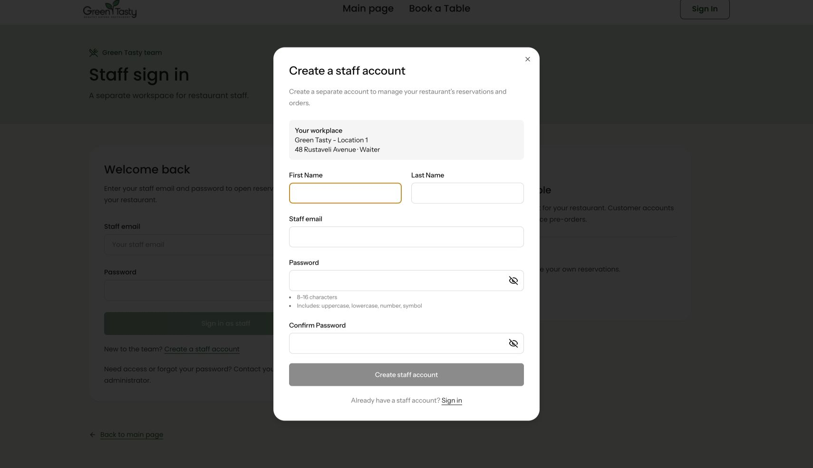
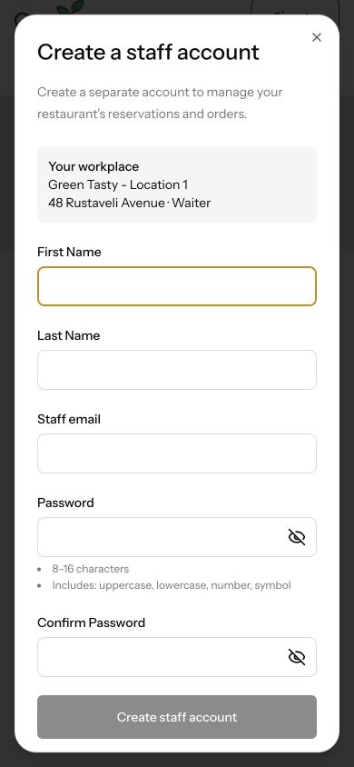

# Отдельная регистрация персонала — 28 октября 2026

По запросу владельца на странице `/staff/login` под кнопкой входа добавлена ссылка **Create a staff account**. Она открывает отдельное модальное окно. Обычная регистрация посетителя и верхняя навигация остаются отдельными.

Для согласованной демонстрации регистрация свободная, без приглашений и почтовых кодов. Форма запрашивает имя, фамилию, новый email, пароль и подтверждение. Рабочее место показано до отправки. Новый пользователь и его активная роль `waiter` создаются одной транзакцией для ресторана `location-1`, после чего сеанс обновляется и открывается панель персонала. Присланные клиентом роль и ID ресторана не используются. Существующий email нельзя перезаписать или повысить через эту форму.

Серверные настройки: `STAFF_REGISTRATION_ENABLED` (по умолчанию `true` для этой демонстрации), `STAFF_REGISTRATION_RESTAURANT` (по умолчанию `location-1`). Новых миграций нет. Настройка выключения закрывает регистрацию, сохраняя отдельный вход существующего персонала. Отсутствующий или неактивный ресторан не позволяет создать аккаунт без рабочего места.

## Проверено

- Полный набор SQLite: **556 пройдено, 28 пропущено**, 6088 утверждений.
- MySQL, отдельная база `testing`: **23 пройдено**, 277 утверждений — регистрация персонала и посетителя, отдельный вход, права доступа.
- Интерфейс: **276 тестов пройдено**. Проверены отдельный endpoint и CSRF-заголовок, ошибки полей, несовпадение паролей, защита от двойного нажатия, таймер ограничения запросов, очистка секретов при закрытии и игнорирование позднего ответа.
- CSRF на сервере, ротация сеанса, хеширование пароля, отсутствие писем/кодов, отказ в доступе к чужому ресторану, отказ при существующем email, общий лимит запросов регистрации проверены серверными тестами.
- TypeScript, lint/форматирование, PHPStan, Pint и клиентская/SSR-сборка прошли. Сборка сообщает прежнее необязательное предупреждение о пакете `fontaine` для оптимизации запасных шрифтов.
- В браузере на изолированном стенде `127.0.0.1:18087`: открытие модального окна, ошибка несовпадения паролей, включение кнопки после исправления, закрытие с возвратом фокуса к ссылке, повторное открытие с пустыми полями. На ширине **390 px** горизонтального переполнения нет; окно прокручивается.

Создание аккаунта и переход в панель проверены автоматизированными тестами на SQLite и MySQL. В браузере новый аккаунт персонала не создавался. Рабочие аккаунты, пароли и брони не изменялись; деплой не выполнялся.

