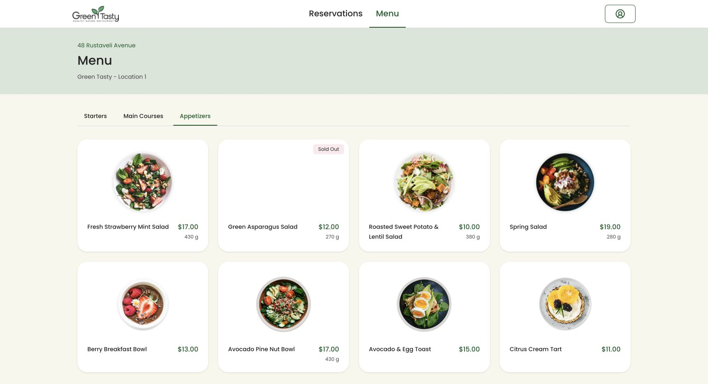

# Проверка рабочей зоны персонала — 28 октября 2026

Вход персонала ведёт в рабочую панель своего ресторана. Навигация определяется ролью аккаунта, включая страницы настроек: **Reservations / Menu**, без клиентских **Main page / Book a Table / My reservations**. Каталог персонала расположен на `/staff/restaurants/{restaurant}/menu`; доступ к нему проверяется по рабочему месту. Описание блюда открывается без кнопки клиентского предзаказа.

Клиентские страницы для персонала перенаправляются на `/staff/enter`. Клиентские JSON-запросы и изменения брони/предзаказа отклоняются с HTTP 403. Старые личные брони сотрудника при этом не изменяются. При неактивном рабочем месте клиентские права не появляются. Отдельная регистрация и клиентские сценарии сохранены.

## Проверено

- В браузере на изолированной копии: вход официанта, рабочая навигация, возврат из `/book` в панель, переход в отдельное меню, переключение категорий и карточка Spring Salad без кнопки предзаказа. Меню аккаунта содержит **Staff workspace**, настройки и выход.
- Серверные тесты SQLite: **561 пройден, 28 пропущено** (6208 проверок).
- Проверки персонала, входа, регистрации, заказов и просмотра предзаказов на отдельной MySQL-базе `testing`: **45 пройдено**, 603 проверки.
- Тесты интерфейса: **283 пройдено**, 32 файла.
- TypeScript, PHPStan, Pint, форматирование, lint, сборка клиента и SSR — без ошибок.

Рабочая база и существующие аккаунты в рамках этой задачи не изменялись. Деплой не выполнялся.

