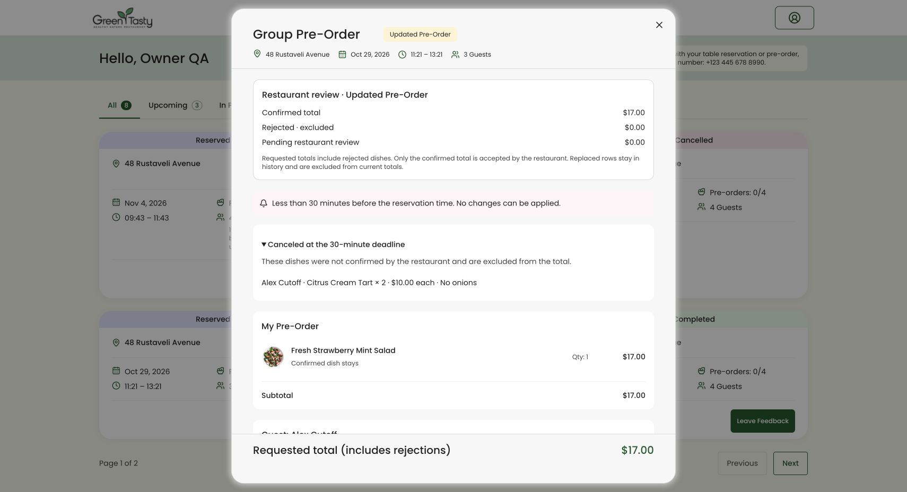
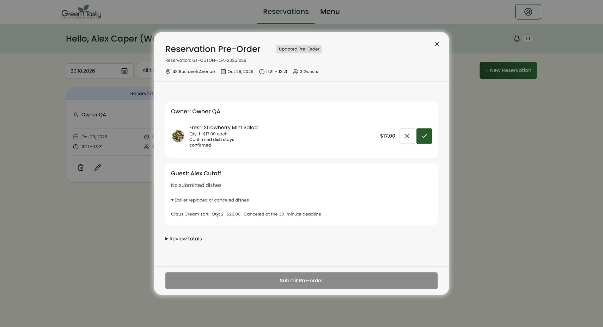
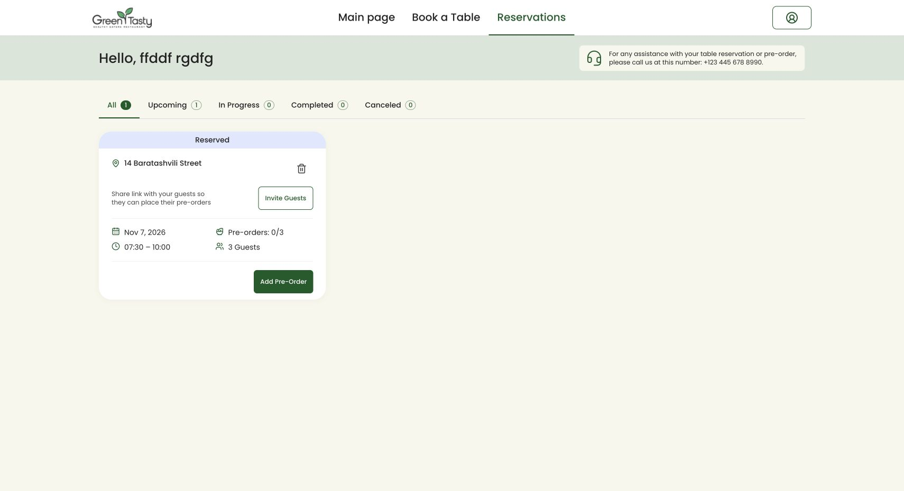

# Предзаказ: предупреждение и автоматическая отмена по сроку

Дата: 29.10.2026. Ветка: `test/full-application-qa`.

Закрыт оставшийся функциональный пробел из проверки сценариев владельца: предупреждение T−45 теперь соответствует фактической отмене неподтверждённых рестораном блюд в T−30. Полное попиксельное совпадение всех страниц Figma этим изменением не подтверждается. Проверка остальных сценариев описана в [предыдущем отчёте](../qa-2026-10-28/owner-flows-final-ru.md).

## Поведение

- Между 45 и 30 минутами до брони показывается предупреждение с оставшимся временем, если есть неподтверждённые блюда. Сохранение выбора гостем и отправка группы ещё не означают подтверждение рестораном.
- В момент T−30 неподтверждённые и отклонённые строки исключаются из действующего состава и суммы. Отметка официанта без опубликованного решения тоже не считается подтверждением.
- Опубликованные рестораном подтверждения сохраняются вместе с ценой, количеством и примечаниями. Забронированные места и участники не удаляются.
- Отменённые строки остаются в истории с `cancelled_at`; незавершённые дополнительные гостевые корзины сохраняют исходный JSON и получают отметку отмены. Повторный запуск не меняет их снова.
- Новые изменения предзаказа, в том числе позднее решение персонала, блокируются сервером. Успешные повторные запросы, которые только возвращают прежний результат, остаются идемпотентными.
- Уже открытые меню и модальные окна блокируют управление по серверному сроку и запрашивают актуальный состав, когда завершится текущий запрос. Несохранённые локальные изменения сбрасываются с уведомлением.
- Автоматическая обработка выполняется планировщиком; авторизованное открытие списка/заказа также синхронизирует просроченный состав. Чужой пользователь не может вызвать изменение другой брони через запрещённый просмотр.

## Проверки

| Проверка                            | Результат                                    |
| ----------------------------------- | -------------------------------------------- |
| Полный PHP-набор, SQLite `:memory:` | 574 пройдено, 28 пропусков, 6458 утверждений |
| Полный PHP-набор, MySQL `testing`   | 595 пройдено, 7 пропусков, 6556 утверждений  |
| Cutoff и список броней, SQLite      | 37 пройдено, 762 утверждения                 |
| Vue/Vitest                          | 287 пройдено, 32 файла                       |
| TypeScript                          | Пройдено                                     |
| PHPStan                             | 0 ошибок                                     |
| Pint                                | Пройдено                                     |
| Форматирование и lint интерфейса    | Пройдено                                     |
| Клиентская и SSR-сборка             | Пройдено                                     |

На SQLite пропущены проверки, требующие MySQL, и необязательные сценарии двухфакторной аутентификации. На MySQL пропущены 4 сценария отключённой двухфакторной аутентификации и 3 проверки отката DDL, которые выполняются на SQLite.

Регрессии покрывают точные границы T−45/T−30 и последнюю разрешённую секунду, опубликованные подтверждения, отклонения, неопубликованные решения, сохранение истории/цен/примечаний, дополнительные корзины, повторный запуск, версии выбора, запрет чужого доступа и неизменность явно завершённых/отменённых броней. UI-тесты проверяют обновление уже открытого окна после срока и блокировку действий.

Локальный повторный PHP-запуск без явного `DB_CONNECTION` сначала не смог разрешить Docker-имя `mysql` с хоста. Повтор с явно указанным SQLite прошёл; полный MySQL-набор выполнен внутри контейнера. Ошибок приложения в этих проверках не осталось.

## Проверка в Chrome

Использована отдельная SQLite QA-копия на порту 18088 с новой миграцией. Клиент и официант вошли в раздельные сессии. Рабочая база `laravel` не использовалась для этих действий.

Контрольная бронь №42: подтверждённый салат $17.00 и неподтверждённый десерт 2 × $10.00. После срока:

- у владельца действующий итог и подтверждённая сумма — $17.00;
- десерт исключён из суммы, сохранён в раскрываемой истории с количеством 2 и примечанием `No onions`;
- кнопки изменения/удаления/отправки отсутствуют у владельца;
- у официанта подтверждённый салат виден, отменённый десерт находится в истории, решения и отправка недоступны;
- захваченных предупреждений и ошибок консоли обеих тестовых вкладок нет.

Ожидание перехода времени в реальном браузере не выполнялось: точная граница и обновление открытых окон проверены управляемыми часами в автоматических тестах. Браузером проверено состояние после срока.





## Запуск в рабочей версии

Добавлена обычная миграция с двумя nullable-полями `cancelled_at`. **29.10.2026 в 09:35 по Киеву она применена к локальной рабочей базе по прямому разрешению пользователя.** Выполнена только эта миграция через `migrate --path=database/migrations/2026_10_29_000000_add_pre_order_cutoff_cancellation.php`; остальные миграции уже были установлены.

Перед применением сохранён приватный SQL-дамп вне репозитория: `/private/tmp/green-tasty-before-cutoff-20261029-0934.sql` (права `0600`, 883604 байта). Проверка до и после: 15 пользователей, 21 бронь, 12 предзаказов, 143 строки блюд и 4 дополнительные корзины. Количество записей сохранилось; сброс базы и посев не выполнялись.

На другом сервере перед использованием нового кода миграцию необходимо установить обычным способом проекта:

```sh
./vendor/bin/sail artisan migrate
```

Для автоматической обработки без открытых страниц на сервере должен каждую минуту запускаться Laravel scheduler (`php artisan schedule:run` через cron). В расписание добавлена команда `pre-orders:expire` с защитой от перекрытия запусков; её регистрация подтверждена через `schedule:list`. Постоянный процесс scheduler на компьютере пользователя не устанавливался. При открытии авторизованных страниц обработка выполняется также в запросе. Массовая команда `pre-orders:expire` против рабочей базы не запускалась.

Миграция не удаляет таблицы и записи. Не использовать `migrate:fresh` или повторный посев для установки этого изменения.

## Исправление загрузки рабочей страницы

Причина сообщения «We couldn’t load your reservations» — SQL-запрос к `cancelled_at` до установки новой миграции. Кроме установки миграции добавлена совместимость с прежней и частично обновлённой схемой: до появления обоих полей отмена не выполняется, а список броней, меню владельца/гостя и просмотр персонала продолжают загружаться. После появления обоих полей отмена автоматически доступна, перезапуск кода не требуется.

Три регрессии физически удаляют одно или оба поля исключительно в транзакционной SQLite-тестовой базе. Они проверяют deferred-загрузку реальной карточки, суммы, дополнительную корзину гостя, просмотр персонала, отсутствие изменения выбора и безопасный пропуск команды отмены. Отдельные проверки с установленной схемой подтверждают обычную отмену в T−30. Рабочая база этими тестами не затрагивалась.

После миграции страница `http://localhost:8080/reservations` проверена в существующей сессии пользователя и перезагружена. Карточка брони №21 отображается, ошибки загрузки нет, захваченных ошибок/предупреждений консоли нет.



## Файлы изменения

Новые:

- `app/Services/PreOrderCutoffService.php`
- `database/migrations/2026_10_29_000000_add_pre_order_cutoff_cancellation.php`
- этот отчёт и три скриншота в `evidence/`

Изменены для срока и отмены:

- `app/Models/GuestPreOrderRound.php`, `app/Models/PreOrderItem.php`
- `app/Services/GuestAdditionalPreOrderService.php`, `GuestMenuService.php`, `MyReservationsService.php`, `OwnerGroupPreOrderService.php`, `PreOrderTiming.php`, `ReservationDashboardService.php`, `RestaurantPreOrderReviewService.php`, `WaiterReservationService.php`
- `routes/console.php`
- `resources/js/components/reservations/OwnerGroupPreOrderModal.vue`, `OwnerRestaurantReview.vue`, `RestaurantReviewModal.vue`
- `resources/js/composables/useGuestSelections.ts`
- `resources/js/pages/Dashboard.vue`, `resources/js/pages/guest/Menu.vue`
- `resources/js/types/owner-group-order.ts`, `restaurant-review.ts`
- `tests/Feature/PreOrderCutoffTest.php`, `WaiterPreOrderReviewTest.php`, `OwnerPreOrderRevisionTest.php`, `MyReservationsTest.php`
- `resources/js/components/reservations/OwnerGroupPreOrderModal.test.ts`, `RestaurantReviewModal.test.ts`, `resources/js/pages/guest/Menu.test.ts`
- в исторических отчётах `docs/preorder-cutoff-and-owner-editing.md` и `docs/qa-2026-10-28/owner-flows-final-ru.md` добавлены ссылки на актуальное поведение.

Сохранены существовавшие до этой доработки изменения 14 файлов: иконки в `public`, `AppLogoIcon.vue`, `AuthNotification.vue`, `QuantityControl.vue`, `useOwnerGroupOrder.ts` и его тест, `OwnerGroupPreOrderModal.vue` и его тест, `owner-group-order.ts`, страница персонала `Reservations.vue`, шаблоны `app.blade.php` и `guest.blade.php`. Часть этих файлов также дополнена текущей логикой срока; исправление положения кнопок количества сохранено.

Просмотрен итоговый diff: изменения относятся к перечисленным сценариям и прежним исправлениям. Коммит, push, merge и deploy не выполнялись. В рабочую схему базы `laravel` добавлены только два nullable-поля по разрешению пользователя. Аккаунты и брони не пересоздавались.
